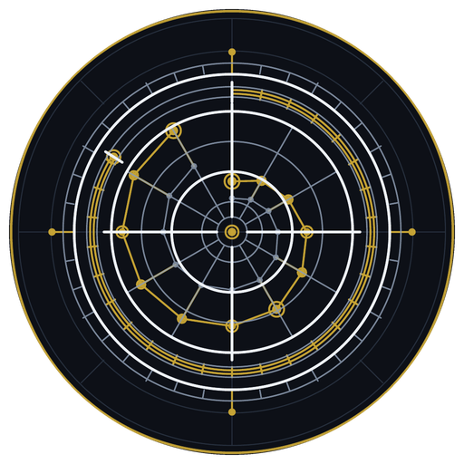
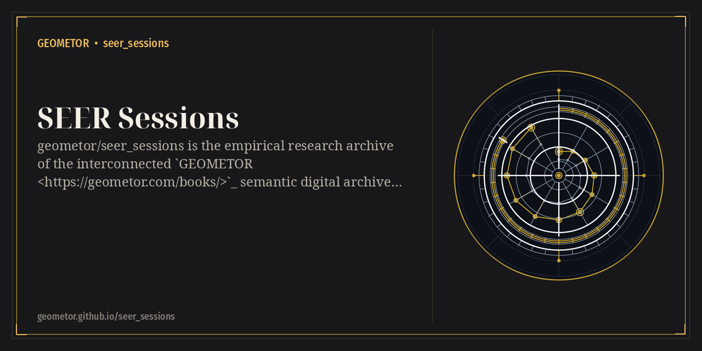

<a href="https://geometor.github.io/seer_sessions/"></a>

# GEOMETOR • seer_sessions

**Visit the Online Archive:** https://geometor.github.io/seer_sessions/

<p align="center">
  <a href="https://geometor.github.io/seer_sessions/"></a>
</p>

**SEER Sessions • Empirical archive of 8,514 ARC-AGI reasoning trials • semantic digital archive**

## Mission

`geometor/seer_sessions` is part of the interconnected [GEOMETOR](https://geometor.com) semantic digital archive. It provides a longitudinal empirical archive, benchmark retrospective, and static web navigator across 14 benchmark suites, 475 session batches, 2,939 unique ARC puzzles, and 8,514 reasoning trials. By capturing every prompt, natural language hypothesis, synthesized Python program, and cell-level execution diff, it liberates empirical AI research into an open, permanent, and fully addressable experimental record across the GEOMETOR corpus.

## Capabilities & Interactive Docs

- [SEER Sessions Web Navigator](https://geometor.github.io/seer_sessions/) — Longitudinal archive and static browser for 8,514 ARC-AGI reasoning trials.
- [Empirical Retrospective](https://geometor.github.io/seer_sessions/retrospective.html) — In-depth analysis of SEER 1.0 program synthesis, failure topologies, and SEER 2.0 architecture.
- [Benchmark Suites](https://geometor.github.io/seer_sessions/benchmarks.html) — Evaluation matrices and pass rates across ARCv1, ARCv2, ConceptARC, and Mini-ARC suites.
- [Puzzle Index](https://geometor.github.io/seer_sessions/puzzles.html) — Comprehensive atlas of 2,939 unique visual reasoning puzzles and candidate solutions.

## Repository Contents

- `docsrc/` — RST retrospective treatises, benchmark analyses, and Sphinx documentation compiled by [PHOTON publish](https://github.com/photon-platform/publish).
- `src/geometor/seer_sessions/` — Corpus loaders, data models, web site builders, and navigator utilities.

## Local Build & Verification

```bash
publish build
```
## Part of the GEOMETOR Knowledge Archive

Explore all **74 Book Codices** and **11 Mathematical Catalogs** at https://geometor.com/books/.
